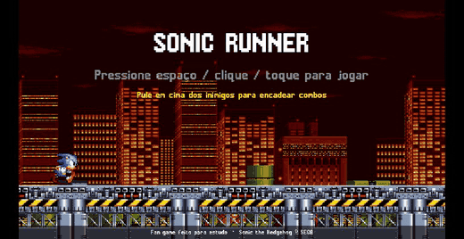

<div align="center">

# Sonic Runner

**Infinite runner jogável no navegador, feito em JavaScript com Kaplay.js.**
Corra, colete anéis e pule em cima dos inimigos para encadear combos.

[](https://haysonicrunner.netlify.app/)


<a href="https://haysonicrunner.netlify.app/"></a>

</div>

## Como jogar

| Ação | Teclado | Mouse | Celular |
|---|---|---|---|
| Começar / pular | `Espaço` | Clique | Toque |

- **Anel:** +1 ponto.
- **Pular em cima de um inimigo:** destrói o inimigo e dá um impulso no ar. O primeiro vale +10; cada novo inimigo antes de tocar o chão aumenta o multiplicador do combo.
- **Encostar num inimigo pelo chão:** fim de jogo.
- A velocidade aumenta a cada segundo. No fim, a partida recebe um **rank de F a S**, e o melhor score fica salvo no navegador.

## Como funciona

O jogo inteiro tem pouco mais de 400 linhas, divididas assim:

```text
src/
├── main.js            carrega sprites, fonte e sons e registra as cenas
├── kaplayCtx.js       instância do Kaplay: resolução 1920×1080 com letterbox e botão "jump" mapeado para teclado, mouse e toque
├── scenes/
│   ├── mainMenu.js    tela inicial com melhor score e rank
│   ├── game.js        partida: spawns, colisões, pontuação e dificuldade
│   └── gameover.js    resultado, recorde e ranks
├── entities/
│   ├── sonic.js       jogador: física de pulo, animações e texto de pontos sobre a cabeça
│   ├── motobug.js     inimigo
│   ├── ring.js        anel
│   └── scenery.js     cenário infinito com parallax, usado pelo menu e pela partida
└── utils/
    └── rank.js        tabela de pontuação → rank
```

Algumas decisões:

- **Parallax com duas cópias por camada.** Fundo e plataformas têm duas cópias lado a lado. Quando a da frente sai da tela, ela vai para trás da outra e as duas trocam de papel. O fundo anda a uma velocidade fixa e baixa, e as plataformas acompanham a velocidade do jogo; a diferença entre as duas cria a profundidade.
- **Entidades como funções-fábrica.** `makeSonic`, `makeMotobug` e `makeRing` devolvem objetos do Kaplay já com sprite, hitbox e tags. As cenas só posicionam e reagem às colisões por tag (`"enemy"`, `"ring"`).
- **Dificuldade por tempo.** A velocidade começa em 300 e sobe 50 a cada segundo. Inimigos e anéis nascem em intervalos aleatórios, então nenhuma partida é igual.
- **Um botão para tudo.** O botão virtual `jump` junta espaço, clique e toque (`touchToMouse`), e o mesmo código funciona no desktop e no celular.
- **Debug só em desenvolvimento.** O inspetor do Kaplay (tecla `D`, com hitboxes e FPS) só liga com `import.meta.env.DEV`.

## Rodando localmente

```bash
npm install
npm run dev      # servidor de desenvolvimento (tecla D abre o modo debug)
npm run build    # build de produção em dist/
```

## Créditos

Projeto de fã, feito para estudo e sem fins comerciais. Sonic the Hedgehog, seus personagens, sprites e músicas pertencem à SEGA.
